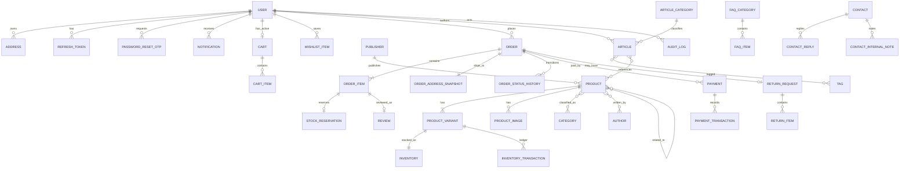

# ERD Proposal — Implementation Level

## Phạm vi và quy ước

- Primary key dùng `BIGINT IDENTITY`; mã hiển thị nghiệp vụ như `orderCode` là khóa riêng.
- Mọi FK dùng `BIGINT`; tên dùng hậu tố `Id`.
- Qua JSON API, mọi PK/FK ID được serialize thành string; frontend/shared types dùng string và không chuyển sang JavaScript number.
- Tiền dùng `decimal(19,0)` vì đơn vị là VNĐ; thời gian lưu UTC.
- Enum dùng code tiếng Anh. Data access là Prisma + repository layer; raw SQL parameterized được phép trong transaction tồn kho khi Prisma không biểu đạt tốt.
- Các bảng có dữ liệu thay đổi đồng thời dùng concurrency token phù hợp SQL Server.

## Sơ đồ quan hệ

## Danh mục bảng và cardinality bắt buộc

### Identity và customer

- `User 1—N Address`; M4 bản deadline không áp giới hạn số địa chỉ. Mỗi User có tối đa một Address active mặc định, được bảo vệ bằng filtered unique index `(userId) WHERE isDefault = 1 AND deletedAt IS NULL`.
- `User 1—N RefreshToken`, `User 1—N PasswordResetOtp`, cho phép thu hồi/hết hạn độc lập.
- `User 1—0..1 Cart` active. Không cần lưu guest cart ở DB trong phiên bản đầu.
- `Cart 1—N CartItem`; unique `(cartId, productVariantId)`.
- `User 1—N WishlistItem`; unique `(userId, productId)`.
- `User 1—N Notification`.

### Catalog

- `Product N—N Category` qua `ProductCategory`; unique `(productId, categoryId)`.
- `Product N—N Author` qua `ProductAuthor`, có `sortOrder`; unique `(productId, authorId)`.
- `Publisher 1—N Product`; ISBN nằm ở ProductVariant, nullable và unique khi khác null.
- `Product 1—N ProductVariant`; phải còn ít nhất một variant active để Product có thể bán.
- `Product 1—N ProductImage`; ảnh variant-specific dùng `productVariantId` nullable và phải thuộc cùng Product.
- `Product N—N Product` qua `RelatedProduct`; lưu một chiều do biên tập, unique `(productId, relatedProductId)`, cấm tự liên kết.
- Không có Supplier/InventoryReceipt trong phiên bản đầu; nhập kho qua adjustment/InventoryTransaction loại `RECEIPT`.

Quyết định M3: Author và Publisher bổ sung `isActive`, `deletedAt`. ProductVariant không hard-delete; SKU immutable và không tái sử dụng. Product có thể giữ `isActive=true` khi không còn variant active nhưng bị loại khỏi public query. SlugReservation giữ vĩnh viễn slug của Product/Category/Author/Publisher. M3 không tạo Inventory, RelatedProduct hoặc HotKeyword.

### Inventory và commerce

- `ProductVariant 1—1 Inventory`; `onHandQuantity >= 0`, `reservedQuantity >= 0`, `reservedQuantity <= onHandQuantity`.
- `ProductVariant 1—N InventoryTransaction`; ledger bất biến, ghi delta và số lượng sau giao dịch.
- `User 1—N Order`; không cascade delete dữ liệu đơn.
- `Order 1—N OrderItem`; snapshot tên, SKU, giá bán và giá vốn tại checkout.
- `Order 1—1 OrderAddressSnapshot`; không FK tới Address để lịch sử không đổi.
- `Order 1—N OrderStatusHistory`; mọi transition có actor nullable cho job hệ thống.
- `Order 1—N Payment`; hỗ trợ nhiều lần thử/ghi nhận, tối đa một payment thành công theo rule service.
- `Payment 1—N PaymentTransaction`; lưu xác nhận/refund/adjustment, actor và thời gian. Refund transaction có `returnRequestId` nullable; unique khi khác null để tối đa một refund/ReturnRequest.
- `OrderItem 1—0..1 StockReservation`; mỗi item chỉ có một reservation, trạng thái ACTIVE/RELEASED/CONSUMED.
- `Order 1—0..1 ReturnRequest`; `ReturnRequest 1—N ReturnItem`. Return lifecycle độc lập, Order giữ `DELIVERED`.
- `OrderItem 1—0..1 Review`; unique `orderItemId`, đồng thời lưu `userId` và `productId` để truy vấn/ownership nhanh.

### Content, support và system

- `Article N—1 ArticleCategory`, `Article N—N Tag` qua `ArticleTag`, `Article N—N Product` qua `ArticleProduct`.
- `FaqCategory 1—N FaqItem`; FAQ có keywords và sort order.
- `Contact 1—N ContactReply`, `Contact 1—N ContactInternalNote`; actor là Staff/Admin.
- `Banner`, `HotKeyword`, `UnansweredChatQuery`, `SiteSetting`, `OperatingCost` và `AuditLog` là các bảng dự kiến độc lập có FK actor/user khi có ngữ cảnh. `HotKeyword` không được tạo trong M3. Không có SearchHistory trong phiên bản đầu.

## Ràng buộc xuyên bảng

1. Checkout khóa/đọc row `Inventory`, kiểm tra available và tạo `Order`, `OrderItem`, `StockReservation`, ledger trong cùng transaction.
2. `Order.totalAmount = subtotal + shippingFee - discountAmount`; phiên bản đầu `discountAmount = 0` nhưng vẫn snapshot để mở rộng/report.
3. Payment Bank/QR tạo `expiresAt`; job hết hạn transition + release reservation idempotent. Một Order có nhiều attempt nhưng chỉ một Payment CONFIRMED tại một thời điểm.
4. Chỉ transition trong state machine; history và audit được ghi cùng transaction với thay đổi trạng thái.
5. Review chỉ được tạo khi Order của OrderItem thuộc user và status `DELIVERED`.
6. Khi Order chuyển `SHIPPING`, transaction giảm onHand/reserved và consume reservation. Hủy trước đó release reservation. Return chỉ tăng onHand sau khi nhận và kiểm tra hàng.
7. ReturnRequest: `REQUESTED -> APPROVED -> COMPLETED` hoặc `REQUESTED -> REJECTED`; yêu cầu trong 7 ngày, partial/full, tối đa một request/order. Refund bằng tổng refundAmount của ReturnItem được duyệt và tối đa một transaction/request.

## Index tối thiểu

- Unique: username/email/phone normalized, SKU, orderCode, slugs theo phạm vi, cart-item, wishlist, review-orderItem và các join pair.
- Search/list: `Product(isActive, createdAt)`, category/product join đảo chiều, author/product join đảo chiều, `Order(userId, createdAt)`, `Order(status, createdAt)`, `Payment(status, createdAt)`, `Inventory(available/threshold)` theo chiến lược computed/query, `Article(status, publishedAt)`.
- Job: filtered/composite index cho order `PENDING_PAYMENT + expiresAt`, token/OTP expiry, notification `(userId, readAt, createdAt)`.

## Quyết định vật lý đã duyệt

PK là `BIGINT IDENTITY`; Prisma + repository layer; SQL Server. Slug không tái sử dụng sau soft delete nên unique reservation phải được giữ bằng bản ghi/tombstone. Ảnh quản trị lưu Cloudinary URL + publicId. Chưa tạo migration trước khi Milestone 1 được duyệt.
